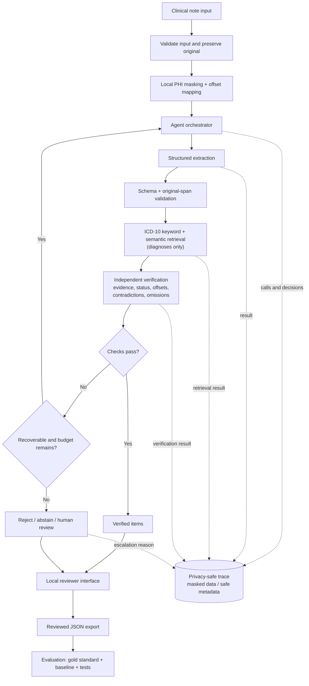

# Architecture, Technology Stack & Development Timeline

**Project:** AI-Powered Clinical Note Extraction and Coding Agent MVP  
**Planning window:** 13–26 October 2026  
**Status:** Proposal pending formal Mirai Labs approval  
**Target:** Localhost, one reviewer, English text notes, free-tier services only

> Do not begin feature implementation or send project clinical notes to an external model until Mirai Labs has approved the architecture, provider and data-handling approach.

# Part I — System Architecture

## 1. Objective and Scope

Propose a local tool that extracts diagnoses, medications, procedures, allergies, and vital signs/key measurements from Mirai Labs-provided clinical notes; links each item to evidence in the original note; retrieves ICD-10 candidates for diagnoses; independently checks proposed results; and lets a reviewer resolve uncertain items.

The SOW describes approximately 5,000 de-identified English notes across about 40 specialties and a supplied ICD-10 table. The original note remains the source of truth. Procedure extraction is included; **procedure-code assignment is excluded**.

## 2. Main Components

| Component | Responsibility |
|---|---|
| Input and source manager | Validate note input and preserve the original text for evidence validation and highlighting. |
| Local privacy layer | Mask identifying information before any approved external model call and maintain masked-to-original offset mapping. |
| Extraction pass | Return structured clinical items, status/attributes, exact evidence spans and original-note offsets. |
| ICD-10 retrieval | Combine keyword and semantic search over the supplied code table; rank diagnosis candidates and allow a no-confident-match result. |
| Independent verifier | Check evidence support, offsets, status, contradictions and likely missed items. It receives the note and proposed items, not the extractor's hidden reasoning. |
| Agent orchestrator | Select tools/passes, inspect outcomes, apply bounded retries, reconcile disagreement, and accept, reject, abstain or escalate. |
| Privacy-safe trace | Record calls, outcomes, retries and decisions using masked payloads or safe metadata only. |
| Local reviewer UI | Show the original note, evidence highlights, structured items, diagnosis-code candidates, review flags/reasons, trace, accept/reject controls and JSON export. |
| Evaluation harness | Compare the agent with a naive single-prompt baseline and measure the required metrics and challenge tests. |

## 3. Mermaid Architecture Diagram



### How to Read the Mermaid Diagram

Follow the arrows from top to bottom. The boxes describe work the system does; the diamond shapes represent decisions.

| Diagram step | What the system does | Example |
|---|---|---|
| Clinical note input | Receives a note from the approved Mirai Labs dataset or local reviewer input. | `Assessment: No evidence of pneumonia. Diagnosis: hypertension.` |
| Validate and preserve original | Checks the input and keeps the exact original note for later evidence checks. | The original sentence is not replaced by a rewritten sentence. |
| Local masking + offset mapping | Masks identifying information locally before an approved external call and tracks how positions map to the original note. | If a name is replaced with `[NAME]`, the system must still know where cited evidence lies in the original note. |
| Agent orchestrator | Chooses the next tool/pass and manages retries within time/call limits. | It calls extraction first, then retrieval and verification as required. |
| Structured extraction | Proposes entities, statuses, attributes, and evidence spans. | It records pneumonia as a negated mention, not a present diagnosis. |
| Schema + span validation | Checks required fields and whether the cited offsets point to the stated evidence in the original note. | A span outside the note or pointing to unrelated text fails validation. |
| ICD-10 retrieval | Searches the supplied code table for diagnosis candidates only. | It ranks candidates for hypertension; it does not assign a procedure code. |
| Independent verification | Checks evidence, status, contradictions, and possible omissions independently. | It checks that “No evidence of pneumonia” is not misread as current pneumonia. |
| “Checks pass?” decision | Determines whether an item meets the evidence and verification rules. | A supported item can proceed; a failure is not automatically accepted. |
| “Recoverable and budget remains?” decision | Retries only when a problem may be fixed and the approved retry budget is not exhausted. Otherwise the system rejects, abstains, or flags for review. | A malformed response may be retried once if allowed; unresolved disagreement goes to review. |
| Reviewer UI and JSON export | Shows evidence and decisions, lets the reviewer accept/reject, and exports reviewed output. | The reviewer can inspect the source text and why an item was flagged. |
| Evaluation harness | Compares results with labelled reference data and the naive baseline. | It calculates metrics; the diagram does not imply that targets have already been achieved. |
| Dashed arrows to privacy-safe trace | Record process activity and decision outcomes, not a separate inference step. | Log which pass ran and its result without saving protected note text. |

The orchestrator controls retries and decisions. A note may contain verified items and flagged items together; the system need not treat the entire note as correct just because one item passes.

## 4. Processing and Acceptance Rules

1. **Preserve the original note.** Keep it as the source for span validation and UI highlighting.
2. **Mask locally.** Before any approved external call, mask identifiers and map positions from masked text back to original-note character offsets.
3. **Extract and validate.** Check the structured schema and verify that spans map to the original note.
4. **Retrieve codes.** Search the supplied ICD-10 table for diagnosis candidates only; do not force a code when no candidate is sufficiently supported.
5. **Verify independently.** Check whether evidence supports the item and whether the status, offsets, context, and contradictions are correct; also check for likely omissions.
6. **Reconcile.** Accept only items that pass schema, offset, evidence and verification checks. Reject unsupported or contradicted items. Abstain when evidence/coding confidence is insufficient. Send unresolved items for review.
7. **Trace safely.** Log tool calls, retry reasons and decisions without exposing protected information.
8. **Review and export.** Allow the reviewer to accept/reject items, inspect reasons and export reviewed JSON.

### Worked Example: Source Note → System Actions → Example Output

**Fictional source note (for explanation only):**

```text
Assessment: No evidence of pneumonia. Diagnosis: hypertension. Medication: amlodipine 5 mg orally once daily. Allergy: penicillin.
```

This shows how the same note moves through the system:

| Source information | System action | Expected handling |
|---|---|---|
| “No evidence of pneumonia” | Extract the diagnosis mention, check negation and verify its evidence. | Preserve the mention as `negated`; do not treat pneumonia as a present diagnosis. |
| “hypertension” | Extract the diagnosis, then search the supplied ICD-10 table. | Validate the source span and rank supported code candidates; do not invent a code. |
| “amlodipine 5 mg orally once daily” | Extract medication name, dose, route and frequency. | Keep only attributes stated in the note and cite the original text. |
| “penicillin” after “Allergy:” | Extract allergy information and verify the source context. | Record it as a documented allergy mention; do not infer extra details. |

**Illustrative structured output** (not actual model output and not yet the final agreed schema). For this example, offsets are zero-based, with the start included and the end excluded:

```json
{
  "note_id": "example-001",
  "items": [
    {
      "category": "diagnosis",
      "entity": "pneumonia",
      "status": "negated",
      "evidence_text": "No evidence of pneumonia",
      "start_offset": 12,
      "end_offset": 36
    },
    {
      "category": "diagnosis",
      "entity": "hypertension",
      "status": "present",
      "evidence_text": "hypertension",
      "start_offset": 49,
      "end_offset": 61
    },
    {
      "category": "medication",
      "entity": "amlodipine",
      "dose": "5 mg",
      "route": "oral",
      "frequency": "once daily",
      "evidence_text": "amlodipine 5 mg orally once daily",
      "start_offset": 75,
      "end_offset": 108
    },
    {
      "category": "allergy",
      "entity": "penicillin",
      "status": "documented",
      "evidence_text": "penicillin",
      "start_offset": 119,
      "end_offset": 129
    }
  ]
}
```

The offsets above point to the exact substrings in the fictional source note. In the actual implementation, the offset convention and field names must be finalized in the approved schema. ICD-10 codes are intentionally not shown here because candidates must come from the supplied reference table and then be verified.

**Important:** “Negated” does not necessarily mean the mention must be erased. The system may preserve the negated mention with its status so a reviewer can understand the context; it must not misreport it as a current positive diagnosis.

The note text is untrusted input: embedded instructions must not override system rules or change tool permissions. On provider failure or a rate limit, fail safely or defer processing; do not fabricate results or silently switch to an unapproved provider.

## 5. Required Evaluation

Evaluate against a naive single-prompt baseline using the same agreed evaluation notes. Define entity matching and partial-match rules before evaluation; report failures as well as successes.

| Evaluation item | SOW requirement / target |
|---|---|
| Gold standard | At least 100 manually labelled notes across at least 10 specialties, labelled before prompt tuning; include diagnosis, medication and procedure spans/status, plus correct ICD-10 diagnosis labels. |
| Entity extraction | Precision, recall and F1 for diagnoses, medications and procedures; diagnosis F1 ≥ 0.80 and medication F1 ≥ 0.85. |
| Baseline | Proposed agent must measurably outperform the naive single-prompt baseline. |
| Evidence faithfulness | 100% of accepted items must be supported by the cited original-note span; one fabricated/unsupported accepted item fails this target. Use programmatic offset checks plus sampled manual review. |
| Status | At least 90% correct status for accepted diagnoses and medications. |
| ICD-10 | Report top-1 and top-3; top-3 accuracy ≥ 75%. |
| Contradictions | At least 20 modified notes; flag at least 80% of contradictions. |
| Rare diagnoses | At least 10 cases; correct no-confident-match behaviour ≥ 80% where the supplied table/evidence does not support a reliable match. |
| Adversarial cases | At least 10 notes with embedded instructions and/or protected information; 100% correct handling. |
| Abstention / review | Report flagging precision and recall, and show whether flagged items are harder than accepted items. |
| Operations | Median end-to-end latency < 30 seconds/note on the approved free-tier setup; report calls per note, retries and quota/cost observations. |
| Error analysis | Explain at least three poor-performing cases. |

These are acceptance targets, not measured results. Mark each target **Pass**, **Fail**, or **Not yet measured** only after evaluation. The annotation guideline and final evaluation split must be defined before prompt tuning.

## 6. Privacy, Risks and Approval Gate

- Keep raw-note handling local; do not commit the SOW, clinical datasets or patient records to GitHub.
- Mask identifying information before any approved external model call. Masking alone does not guarantee that every identifier has been removed.
- Review and obtain approval for provider data-use and retention terms before sending any project note to an external model.
- Never expose protected information in traces, logs, exports or demos.
- Preserve original offsets through masking and validate the mapping.
- Confirm the actual required processing volume and account-specific model quota; two model calls per note can make free-tier throughput a constraint.
- Do not reduce the required gold-standard or challenge-set sizes silently. Raise timeline, privacy, data-access or quota blockers with Mirai Labs.
- The MVP excludes OCR/scanned or handwritten notes, procedure-code assignment, EHR/billing integration, cloud or multi-user deployment, fine-tuning, external clinical-note sourcing, paid API keys and GPU-dependent infrastructure.

### Possible future extensions — not part of this MVP

These are options for a later phase only. They do not change the current SOW scope and require written agreement from Mirai Labs before work begins.

| Option | Potential benefit | Additional controls needed |
|---|---|---|
| OCR and document ingestion | Accept scanned clinical PDFs/images; handwriting support would need separate feasibility testing because recognition errors can be substantial. | Local processing where required, OCR confidence checks, page/region provenance, text-quality validation, and human review for uncertain output. Character offsets alone may not be enough; the output schema may also need page numbers and bounding boxes. |
| Input-quality checks | Detect empty, truncated, duplicate or garbled notes before extraction. | Define validation rules and report rejected inputs without losing the original source. |
| Review prioritization | Put low-confidence, contradictory or poorly supported items at the top of the review queue. | Calibrate confidence against labelled data; do not treat model confidence as proof of correctness. |
| Reviewer feedback and error analytics | Record reviewer corrections and recurring failure types to guide later improvements. | Keep feedback privacy-safe and separate from the independent final test set; no automatic prompt tuning or fine-tuning without approval. |
| Resumable batch processing | Resume interrupted runs and report progress when processing large approved datasets. | Track per-note status, retries and quota use without exposing protected note text. |

**Recommendation:** Keep OCR as a documented future option, not an MVP feature. Start with printed/scanned documents before considering handwriting. If Mirai Labs later approves OCR, add a separate input-quality and OCR evaluation set, retain page-level evidence, and route low-confidence OCR results to human review.

# Part II — Technology Stack and Justification

## 7. Frontend, Backend, Database and Supporting Technologies

The following stack is proposed for the local MVP. These are design choices, not implemented or approved components.

| Layer | Proposed technology | Purpose and reason |
|---|---|---|
| **Frontend / reviewer UI** | **Streamlit** | Local interface for showing the original note, evidence highlights, extracted fields, diagnosis-code candidates, flagged items, trace and accept/reject controls. It avoids a separate React frontend for this single-reviewer MVP. |
| **Backend / application logic** | **Python 3.12.x** | Handles note processing, validation, retrieval, verification, decisions, JSON export and evaluation. Python is a direct fit for NLP and evaluation; pin the exact version after compatibility testing. |
| **Agent orchestration** | **Explicit Python agent loop** | Chooses tool calls, inspects results, applies bounded retries, reconciles disagreement, and decides whether to accept, reject, abstain or escalate. A small explicit loop is easier to inspect than a large orchestration framework. |
| **LLM / model API** | **Provisional Groq API candidates, subject to approval** | Provides hosted model inference and structured output. Provider terms, model quality, current availability and account-specific free-tier quotas must be checked before use. |
| **Database / local persistence** | **SQLite and local files** | SQLite can store limited local review metadata and evaluation results; local files can hold necessary configuration and evaluation artifacts. No separate database server is proposed. Do not store protected information in traces or commit patient records to GitHub. |
| **Keyword retrieval** | **SQLite FTS5 or BM25; choose one after testing** | Finds and ranks diagnosis candidates using words from the supplied ICD-10 table. Choose based on implementation simplicity and evaluation results. |
| **Semantic retrieval / vector store** | **ChromaDB with a compatible local embedding model, candidate: bge-small-en** | Supports retrieval of conceptually related code descriptions when wording differs. This is a proposed option; similarity is not proof of clinical correctness. |
| **Schema validation** | **Pydantic 2.x** | Checks required fields and value types. Additional checks are still needed for original offsets, evidence support and clinical meaning. |
| **Local privacy processing** | **Rules plus spaCy NER** | Rules can detect predictable patterns; named-entity recognition can identify some context-dependent identifiers. Neither guarantees complete masking, so it must be tested. |
| **Trace and logging** | **Structured JSON with masked data or safe metadata** | Records tool calls, outcomes, retries and decisions without exposing protected information. |
| **Evaluation** | **Python scripts and automated tests** | Makes entity metrics, span checks, ICD-10 measures, challenge tests and latency/call measurements repeatable. |
| **Version control** | **Git and private GitHub repository** | Tracks changes and supports the required private repository workflow. |

**Layer summary:** Streamlit is the frontend; Python and the explicit agent loop form the backend/application logic; SQLite/local files provide local persistence; ChromaDB is a candidate vector store for semantic retrieval. The supplied ICD-10 table remains the source data for diagnosis-code candidates.

Exact dependency versions and the final retrieval choice must be confirmed through compatibility checks and evaluation after approval.

## 8. Model Candidates and Constraints

Provider documentation was checked on **15 October 2026**. Recheck before implementation because availability and quotas can change.

| Candidate | Proposed role | Important limitation |
|---|---|---|
| Groq `openai/gpt-oss-20b` | First candidate for structured extraction | Listed as supported with strict JSON-schema output; clinical quality still needs evaluation. |
| Groq `qwen/qwen3.8-27b` | Candidate for independent verification | Listed as supported with strict JSON-schema output; verifier quality must be measured. |
| Google `gemini-3.1-flash-lite` | Alternative if policy permits | Free-tier content-use terms require careful privacy review before any clinical note is sent. |

**Provisional configuration:** evaluate `openai/gpt-oss-20b` for extraction and `qwen/qwen3.8-27b` for verification. This is not an approved or proven configuration.

Groq's documentation reviewed for this plan listed free-tier limits of 1,000 requests/day for the proposed models, subject to account-specific limits. At two calls per note, that would theoretically allow up to 500 notes/day before retries or failures. Confirm whether the project needs to process all approximately 5,000 notes or an agreed evaluation subset; do not silently reduce scope.

Provider and technical references:

- Groq: [Supported models](https://console.groq.com/docs/models), [rate limits](https://console.groq.com/docs/rate-limits), [structured outputs](https://console.groq.com/docs/structured-outputs), [data controls](https://console.groq.com/docs/your-data), [deprecations](https://console.groq.com/docs/deprecations).
- Google: [Gemini models](https://ai.google.dev/gemini-api/docs/models), [pricing and data-use terms](https://ai.google.dev/gemini-api/docs/pricing).
- Tools: [Pydantic](https://docs.pydantic.dev/), [Streamlit](https://docs.streamlit.io/), [Chroma](https://docs.trychroma.com/), [spaCy](https://spacy.io/usage), [Python](https://docs.python.org/).

Before implementation, confirm provider approval, current free-tier quotas, model IDs, dependency compatibility, the extraction/verification schemas, offset mapping, retrieval selection and safe traces.

# Part III — Development Timeline

## 9. Milestones

| Date | Deliverable / work | Constraint |
|---|---|---|
| 13 Oct 2026 | Review SOW; identify requirements/questions; begin market research | Planning/research only. |
| 13–14 Oct 2026 | Review products, open-source tools and papers | Record sources and limitations. |
| 14 Oct 2026 | Research presentation | Present findings and gaps. |
| **15 Oct, by 6:00 PM** | Submit solution, architecture, technology-stack rationale and timeline | Mark design choices as proposed. |
| **16 Oct** | Formal architecture/technology review | No feature implementation before approval. |
| 19 Oct | Inspect supplied dataset/code table; finalize annotation guidance; begin labelling; define naive baseline | Labelling must start before prompt tuning. |
| 20 Oct | Continue toward 100 labelled notes/10 specialties; define schema, offsets and evaluation harness | Track coverage and annotation disagreements. |
| 21 Oct | Implement approved local masking, input handling, extraction and schema validation | Test offset mapping and evidence rejection. |
| 22 Oct | Implement ICD-10 keyword/semantic retrieval and no-confident-match | Use supplied table; monitor quota. |
| 23 Oct | Implement verifier, bounded retries, reconciliation, abstention/escalation and safe trace; integrate reviewer controls | Test contradictions, omissions, retries and embedded instructions. |
| 26 Oct | Complete UI/JSON export; run evaluation/challenge sets; analyze at least three failures; finalize README, user guide, 5–8 minute demo and defense materials | Report unmeasured targets honestly. |

## 10. Schedule Risks

The planned build window is six working days after the approval gate. It is tight for annotation, multi-pass extraction/verification, UI integration and full evaluation. Progress depends on timely dataset access, approved provider/data handling and sufficient free-tier quota.

Track labelled-note count and specialty coverage daily. If a dependency threatens a required deliverable, raise it with Mirai Labs; do not silently remove required tests or claim unmeasured success.

---

**Submission status:** This is a planning proposal. Architecture, model/provider choice and stack remain subject to Mirai Labs' formal approval.  
