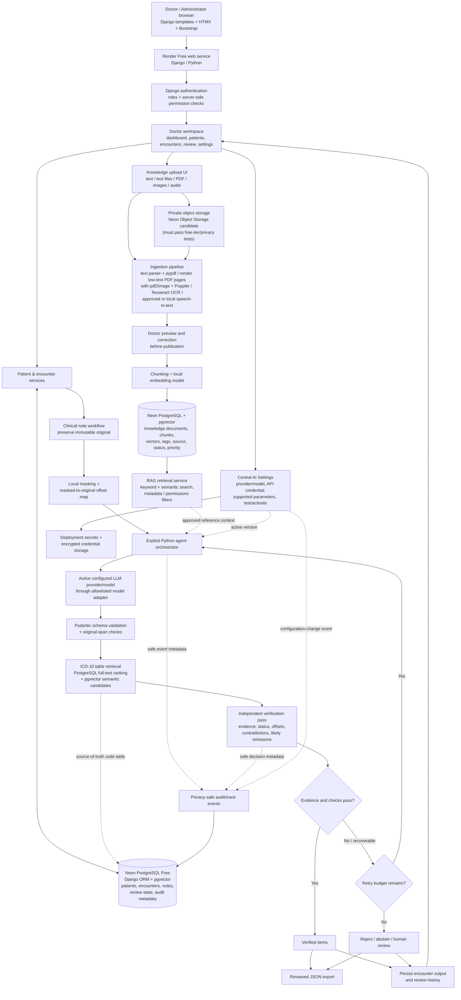

# Revised System Architecture, Technology Stack, and Hosted Workflow

**Project:** AI-Powered Clinical Note Extraction and Coding Agent  
**Revision:** 16 October 2026  
**Status:** Proposed design; expanded requirements, hosting, provider, and data handling pending formal Mirai Labs approval.

> The revised doctor workspace is materially broader than the original SOW. Use synthetic data for public-hosting and UI tests. Do not upload Mirai Labs clinical notes or enable external model processing until the exact scope, provider, hosting, storage, and data-handling arrangements are approved in writing.

## 1. Product Direction

The application is designed around the doctor's workflow rather than around individual AI tasks. A doctor signs in, sees authorized patients and recent activity, opens a patient record, reviews current and previous encounters, processes a clinical note, inspects evidence-linked results, manages reference knowledge, and configures/tests the active AI provider/model from a central settings page.

### Doctor-facing navigation

1. **Dashboard:** recent activity, pending review items, recent patients, and useful actions.
2. **My Patients:** searchable list of authorized patients.
3. **Patient Record:** overview, current encounter, prior encounters, clinical notes, diagnosis mentions, medication mentions, allergies, measurements, procedure mentions, and review history.
4. **Clinical Notes / Review:** submit or open a note, inspect extracted items and evidence, accept/reject/flag items, inspect ICD-10 candidates, and export reviewed JSON.
5. **Knowledge Base:** add text, text files, multi-page PDFs, images, and voice/audio; preview/correct extracted content; edit, tag, prioritise, publish, version, deactivate, and re-index knowledge.
6. **Activity / History:** inspect processing runs, review actions, configuration changes, and safe operational events.
7. **AI Settings:** one central place to configure the active provider/model and supported parameters, test connectivity with synthetic input, and activate the saved configuration.
8. **Administration:** manage users and role assignment; restrict to administrators where appropriate.

Do not hardcode patient names, knowledge records, model names, dashboard counters, or uploaded-file lists. Populate these views from persisted data.

## 2. Original SOW vs Expanded Proposal

The original SOW requires extraction, original-source evidence/offsets, diagnosis-code candidates from the supplied ICD-10 table, independent verification, bounded orchestration, safe traces, human review, and quantitative evaluation. Its baseline scope is local/one reviewer/text notes; OCR and cloud/multi-user deployment were excluded.

The expanded proposal adds a hosted doctor workspace, user roles, patient/encounter history, an editable multimodal knowledge base, RAG, model configuration through the UI, cloud database/storage, and a hosted public demo. These are scope changes, not assumed SOW requirements. Obtain written Mirai Labs approval before implementing them against project data. Use synthetic data while approval is pending.

## 3. Main Architecture Diagram (Technology Included)

**Implemented**
%% Generated by https://gitdiagram.com/krupashetty004/clinical-note-extraction-agent
flowchart TD

subgraph group_clinical["Clinical workflow"]
  node_note_input["Clinical note input"]
  node_extraction["Clinical extraction"]
  node_evidence["Evidence and offsets"]
  node_code_candidates["ICD-10 candidates"]
  node_verification["Independent verification"]
  node_reconciliation["Reconciliation and abstention"]
  node_human_review["Human review"]
end

subgraph group_workspace["Doctor workspace"]
  node_doctor_workspace["Doctor workspace [architecture.md]"]
  node_access_control["Roles and permissions [requirements.md]"]
  node_patient_history[("Patient and encounter history [architecture.md]")]
end

subgraph group_knowledge["Knowledge and AI"]
  node_knowledge_base[("Managed knowledge base")]
  node_document_ingestion["Document ingestion"]
  node_rag["RAG retrieval"]
  node_model_settings["Model settings [architecture.md]"]
end

subgraph group_platform["Hosted platform"]
  node_hosted_app["Hosted application [architecture.md]"]
  node_relational_store[("Relational and vector store")]
  node_private_file_storage[("Private file storage")]
end

node_clinician(("Doctor"))

node_clinician -->|"uses"| node_doctor_workspace
node_doctor_workspace -->|"enforces access"| node_access_control
node_doctor_workspace -->|"manages history"| node_patient_history
node_doctor_workspace -->|"submits notes"| node_note_input
node_note_input -->|"extracts items"| node_extraction
node_extraction -->|"links evidence"| node_evidence
node_extraction -->|"retrieves candidates"| node_code_candidates
node_extraction -->|"verifies independently"| node_verification
node_verification -->|"reconciles results"| node_reconciliation
node_reconciliation -->|"routes uncertainty"| node_human_review
node_clinician -->|"manages knowledge"| node_knowledge_base
node_knowledge_base -->|"accepts files"| node_document_ingestion
node_knowledge_base -->|"supplies context"| node_rag
node_doctor_workspace -->|"configures models"| node_model_settings
node_hosted_app -->|"persists records"| node_relational_store
node_hosted_app -->|"stores uploads"| node_private_file_storage

click node_note_input "https://github.com/krupashetty004/clinical-note-extraction-agent/blob/main/docs/solution-proposal.md"
click node_extraction "https://github.com/krupashetty004/clinical-note-extraction-agent/blob/main/docs/solution-proposal.md"
click node_evidence "https://github.com/krupashetty004/clinical-note-extraction-agent/blob/main/docs/solution-proposal.md"
click node_code_candidates "https://github.com/krupashetty004/clinical-note-extraction-agent/blob/main/docs/solution-proposal.md"
click node_verification "https://github.com/krupashetty004/clinical-note-extraction-agent/blob/main/docs/solution-proposal.md"
click node_reconciliation "https://github.com/krupashetty004/clinical-note-extraction-agent/blob/main/docs/solution-proposal.md"
click node_human_review "https://github.com/krupashetty004/clinical-note-extraction-agent/blob/main/docs/solution-proposal.md"
click node_doctor_workspace "https://github.com/krupashetty004/clinical-note-extraction-agent/blob/main/docs/architecture.md"
click node_access_control "https://github.com/krupashetty004/clinical-note-extraction-agent/blob/main/docs/requirements.md"
click node_patient_history "https://github.com/krupashetty004/clinical-note-extraction-agent/blob/main/docs/architecture.md"
click node_knowledge_base "https://github.com/krupashetty004/clinical-note-extraction-agent/blob/main/docs/solution-proposal.md"
click node_document_ingestion "https://github.com/krupashetty004/clinical-note-extraction-agent/blob/main/docs/solution-proposal.md"
click node_rag "https://github.com/krupashetty004/clinical-note-extraction-agent/blob/main/docs/solution-proposal.md"
click node_model_settings "https://github.com/krupashetty004/clinical-note-extraction-agent/blob/main/docs/architecture.md"
click node_hosted_app "https://github.com/krupashetty004/clinical-note-extraction-agent/blob/main/docs/architecture.md"
click node_relational_store "https://github.com/krupashetty004/clinical-note-extraction-agent/blob/main/docs/technology-stack.md"
click node_private_file_storage "https://github.com/krupashetty004/clinical-note-extraction-agent/blob/main/docs/technology-stack.md"

classDef toneNeutral fill:#f8fafc,stroke:#334155,stroke-width:1.5px,color:#0f172a
classDef toneBlue fill:#dbeafe,stroke:#2563eb,stroke-width:1.5px,color:#172554
classDef toneAmber fill:#fef3c7,stroke:#d97706,stroke-width:1.5px,color:#78350f
classDef toneMint fill:#dcfce7,stroke:#16a34a,stroke-width:1.5px,color:#14532d
classDef toneRose fill:#ffe4e6,stroke:#e11d48,stroke-width:1.5px,color:#881337
classDef toneIndigo fill:#e0e7ff,stroke:#4f46e5,stroke-width:1.5px,color:#312e81
classDef toneTeal fill:#ccfbf1,stroke:#0f766e,stroke-width:1.5px,color:#134e4a
class node_note_input,node_extraction,node_evidence,node_code_candidates,node_verification,node_reconciliation,node_human_review toneBlue
class node_doctor_workspace,node_access_control,node_patient_history toneAmber
class node_knowledge_base,node_document_ingestion,node_rag,node_model_settings toneMint
class node_hosted_app,node_relational_store,node_private_file_storage toneRose
class node_clinician toneIndigo
**Storage note:** Neon is the proposed PostgreSQL provider and supports pgvector. Neon Object Storage is the preferred file-storage choice because the current official documentation marks it generally available, S3-compatible, and included at 5 GB per project on the Free plan. Private access controls and Python/S3 compatibility still require an implementation smoke test. If it fails the acceptance checklist, evaluate Supabase Storage Free as a fallback without changing the Neon database decision. Reconfirm allowances before deployment.

## 4. Data Sources Must Stay Distinct

The system has three logically different sources:

1. **Original clinical note:** the evidence source for each extracted claim. Accepted entity evidence and character offsets must point into this original text.
2. **Supplied ICD-10 reference table:** the canonical source for diagnosis-code candidates and code descriptions. Do not invent codes. Procedure-code assignment remains out of scope.
3. **Doctor-managed reference knowledge / patient history:** RAG may retrieve approved reference passages and relevant history for context, but their sources must remain identified and access-filtered. A knowledge-base document is not proof that a diagnosis was written in the current clinical note.

Patient history retrieval must be scoped to the current authorised patient. A query for one patient must never retrieve another patient's notes, encounter content, or identifiers. Reference knowledge and patient-specific history should use separate retrieval scopes or mandatory metadata filters.

## 5. Main Doctor Workflow

### 5.1 Login and dashboard
- Authenticate each user before loading patient, note, knowledge, or AI-settings data.
- Enforce permissions in Django views/services and database queries; hiding a button is not authorization.
- The proposed initial roles are Doctor and Administrator. The Doctor role manages authorized patients/encounters, knowledge records, review decisions, and—if approved—central AI settings. Administrators manage account/role administration and system-wide settings.
- Create synthetic demonstration users and records; never put passwords, real patient data, provider keys, or uploaded clinical files in GitHub.

### 5.2 Patients and encounters
- Search only patients the logged-in doctor is permitted to access.
- Separate a patient's current encounter from previous encounters.
- Keep notes, processing runs, accepted/rejected items, model version identifiers, and review decisions attached to a specific encounter.
- Preserve history instead of silently overwriting a previous extraction.
- Label historical diagnoses and medication mentions with their date/context; do not promote historical mentions to current facts without support in the present note.

### 5.3 Clinical-note extraction
1. Receive an English text note for the approved encounter workflow.
2. Preserve the exact original note as immutable evidence source.
3. Perform local identifier masking before any approved external model call; maintain an explicit map between masked and original character positions.
4. Call the active model configuration using the extraction prompt and strict output contract.
5. Validate the response using Pydantic and additional checks for offsets/evidence; schema validity alone is not correctness.
6. Retrieve diagnosis-code candidates from the supplied code table using keyword and semantic search. Return no-confident-match when unsupported.
7. Run an independent verification pass using the note and proposed items, not the extractor's hidden reasoning.
8. Reconcile outcomes in an explicit Python agent loop. Retry only recoverable failures within a configured call/time budget.
9. Accept only items passing evidence, status, offset, and verification checks; reject unsupported claims, abstain if coding is uncertain, and route unresolved cases to item review or note escalation.
10. Show the original note with evidence highlighting, status, code candidates, flags/reasons, trace-safe process history, and accept/reject controls.
11. Persist review results and export reviewed JSON.

The central settings page normally selects one active provider/model for the application. The same selected model can be invoked with different extraction and verification instructions in separate passes. A distinct verifier model is an optional advanced decision; do not make the doctor configure every task separately unless Mirai Labs specifically asks for it.

### 5.4 Multimodal reference knowledge ingestion
1. Doctor enters text or uploads a supported text file, PDF, image, or audio file.
2. Validate extension, MIME type, actual content, size, and limits; reject unsupported or unsafe files.
3. Store the original object in a private bucket and create a database record with owner, source, status, version, timestamps, category, tags, and priority.
4. Text files are parsed directly. PDFs are parsed page-by-page for selectable text using pypdf; only pages with little/no selectable text are rendered using pdf2image + Poppler and passed to Tesseract OCR. Images use Tesseract OCR. Audio uses a tested local CPU speech-to-text option or an approved free-tier service; it must never silently invoke a paid provider.
5. Show extracted text/transcription for doctor correction and confirmation before publication.
6. Split approved text into traceable chunks; create vectors with a local embedding model; store chunks, vectors, source references, and metadata in PostgreSQL/pgvector.
7. On edit/deactivation, mark old versions and ensure stale chunks are updated or removed from retrieval. Re-indexing failures must be visible.
8. Record source attribution in retrieval results so the doctor can inspect what informed the generated output. For PDF sources, retain the original file reference and page number(s) for each extracted chunk where available.

PDFs, images, and voice are inputs to the **knowledge base** in this expanded scope, not a claim that the original SOW's clinical-note input is now unrestricted multimodal. PDF knowledge ingestion does not automatically change the original SOW exclusion of scanned clinical-note input.

### 5.5 RAG and priority logic
- Retrieve candidates using keyword/full-text matching and vector similarity.
- Apply mandatory permissions and scope filters first; then relevance thresholding, ranking, and optional doctor-configured priority.
- Priority should influence ordering among relevant eligible results; it must not make unrelated or unsafe text outrank better evidence solely because it has a high priority.
- Deduplicate overlapping chunks and keep document title, version, source, and chunk reference.
- Pass only the relevant, approved context to the model.
- Separate reference-knowledge citations from clinical-note evidence offsets; every accepted extracted claim still needs original-note evidence.

A starting ranking can be evaluated as a normalized blend of semantic similarity, lexical relevance, and a small bounded priority adjustment. The weights and threshold must be validated on labelled examples rather than assumed correct.

### 5.6 Central AI Settings
- One settings page selects the approved provider/model and supported generation parameters for the whole application.
- Provide Test Connection, Show Test Result, Save Draft, and Activate actions.
- Test only with synthetic/non-sensitive input. Check connectivity, model availability, response status, schema output when required, latency, and errors.
- Restrict provider options/endpoints to a documented allowlist. Arbitrary URLs are not accepted.
- Mask API keys in the UI. Store credentials encrypted using an application encryption key kept in deployment environment secrets; never log keys.
- Record configuration ID/version, who changed it, time, provider/model identifier, and test result. Never log the secret.
- A successful connectivity test does not prove clinical accuracy or data-policy approval.
- On invalid key, unsupported model, or quota exhaustion, preserve current active config unless the user explicitly confirms a tested new one. Do not switch providers silently.

## 6. Proposed Technology Stack

| Layer | Proposed technology | Reason / constraint |
|---|---|---|
| Frontend | Django templates + HTMX + Bootstrap | No React; simple server-rendered dashboard, dynamic tables, forms, and review controls. |
| Web/backend | Django / Python | Built-in ORM, migrations, admin, authentication, groups, and permissions fit a patient/encounter-centric application. |
| Hosting | Render Free web service | Public demo URL; may sleep/cold-start, so show loading states and validate its current free limits. |
| Relational database | Neon Free PostgreSQL | Persistent hosted relational store for users, patients, encounters, documents, notes, review records, and audit metadata. |
| Vector retrieval | PostgreSQL pgvector on Neon | Store embeddings and run semantic search without a separate vector database service. |
| File storage | Neon Object Storage (S3-compatible) | Stores original text files, PDFs, images, and audio outside the app filesystem; private access and quota must pass smoke tests. Supabase Storage Free is a fallback if needed. |
| Embeddings | Local sentence-transformers model, candidate bge-small-en | Avoid paid embedding API; benchmark CPU/memory, relevance, and build time on free hosting. |
| Keyword search | PostgreSQL full-text search | Search knowledge/ICD text alongside vector retrieval; compare results with semantic-only and lexical-only baselines. |
| PDF text extraction | pypdf | Extracts selectable text page by page without OCR; scanned/image-only pages require OCR fallback. Preserve page numbers. |
| PDF page rendering for OCR | pdf2image + Poppler, only when needed | Converts only low/no-text PDF pages to images before OCR; test native dependency on Render Free. |
| Image-to-text | Tesseract OCR | Open-source and no OCR API charge; only supports practical scope after quality and host-resource tests. |
| Audio-to-text | Tested local CPU model or approved free-tier transcription endpoint | Free quotas and CPU/memory are constraints. No paid API or silent fallback. |
| AI text generation | Provider/model adapter with selectable allowlisted provider/model | Doctor-facing central setting; provider use remains subject to current terms and approval. |
| Schema validation | Pydantic plus custom evidence/offset checks | Validates structure and source support separately. |
| RAG | Python service, metadata-filtered hybrid retrieval | Keeps retrieval logic explicit/testable and distinguishes reference knowledge, patient history, and ICD candidates. |
| Traces/audit | Structured safe events stored in PostgreSQL | No keys or protected raw notes in operational traces. |
| File validation | Allowlisted MIME/extensions, size limits, content checks | Treat uploads as untrusted input. |
| Testing | pytest/Django tests and reproducible evaluation scripts | Test permissions, persistence, extraction metrics, retrieval, and quotas. |
| Version control | Private GitHub | No SOW, real patient notes, credentials, or source uploads committed. |

### Why Neon instead of Supabase?
Neon is a PostgreSQL hosting provider, not an alternative database engine. Both Neon and Supabase provide hosted PostgreSQL; the architecture chooses Neon for the database and pgvector. It does not rely on Supabase's application authentication because Django handles login and role permissions. Neon Object Storage is the preferred bundled file-storage choice; current official documentation marks it generally available and lists 5 GB per project on the Free plan. Its private access, quota, and integration still need an implementation test. Supabase Storage Free remains a fallback if Neon Object Storage does not meet those conditions. Avoid deploying both storage systems unless there is a demonstrated need.

### Free-tier constraints
- Current Neon Free limits checked on 16 October 2026 include 1 GB PostgreSQL storage/project, 100 CU-hours/project/month, 5 GB public network transfer/project/month, and 5 GB Object Storage/project. Recheck quotas before deployment.
- Current Supabase Free documentation lists 500 MB database size, 1 GB storage, and 5 GB egress; projects can be paused under free-plan rules.
- Render Free web services can sleep and use ephemeral local storage; do not treat the application filesystem as persistent.
- AI APIs, OCR, and transcription must respect free quotas and input limits. The system must explain/defer on quota exhaustion and must not trigger paid fallback.
- Keep synthetic demo data and monitor limits. Free tiers are suitable for a bounded evaluation demo, not a promise of unlimited or production-grade availability.

References:
- Neon plans: https://neon.com/docs/introduction/plans
- Neon Object Storage (GA; 5 GB/project on Free): https://neon.com/blog/building-neon-object-storage and https://neon.com/blog/neon-backend-is-ga
- Neon pgvector: https://neon.com/blog/optimizing-vector-search-performance-with-pgvector
- Render free services: https://render.com/docs/free
- Supabase billing: https://supabase.com/docs/guides/platform/billing-on-supabase
- Supabase storage access: https://supabase.com/docs/guides/storage/buckets/fundamentals

## 7. Main Data Model (Logical Proposal)

- **User / DoctorProfile:** Django user ID, role/group, active status, profile metadata.
- **Patient:** non-hardcoded patient record with internal ID and minimum necessary fields.
- **PatientAccess:** relationship describing which doctors can access each patient, unless a simpler documented practice-wide permission model is approved.
- **Encounter:** patient ID, encounter date, status, creating doctor, and links to encounter notes.
- **ClinicalNote:** encounter ID, original text, note version/source, author, timestamps. Store only approved data; public demo records must be synthetic.
- **ExtractionRun:** note/version ID, config-version ID, model identifier, status, latency, call count, safe trace reference.
- **ExtractedItem:** type, entity, attributes, status, evidence text, original offsets, code candidates, verification result, reviewer decision.
- **KnowledgeDocument:** owner, storage key, source filename, source type, title, category, tags, priority, status, version, extracted text, review/publication state.
- **KnowledgeChunk:** document/version ID, chunk index/text, embedding vector, searchable text, metadata and source reference.
- **ICDCode:** code, description and any supplied metadata from the approved canonical table; do not invent or externally substitute codes.
- **AIConfiguration:** provider/model identifier, supported parameters, encrypted credential reference, active/test status, version and updated-by metadata. Never store API keys as plaintext.
- **ReviewAction / AuditEvent:** who did what and when, entity/config identifiers, and safe result metadata.

This is a proposed schema. Final fields, indexes, retention, and access controls must be tested and approved.

## 8. Security and Reliability Controls

- Enforce authentication and permissions server-side for every patient, encounter, note, document, export, and configuration endpoint.
- Test horizontal access control: Doctor A must not retrieve Doctor B's patient records unless explicitly authorised.
- Keep knowledge-source retrieval and patient-history retrieval logically separate and scoped.
- Validate uploads for type, size, content and PDF page count; limit PDF rendering/OCR work and processing time; store files privately. Do not use public object URLs for sensitive files.
- Use short-lived signed file URLs if needed and verify the ownership/access decision before generating a link.
- Avoid remote image/audio parsers that execute untrusted content. Use controlled subprocesses and timeouts for local OCR/transcription.
- Keep original note text authoritative for offsets; test masking-to-original mapping, including repeated text occurrences.
- Treat clinical note and uploaded knowledge text as untrusted input; document text must not override system instructions or provider policies.
- Limit retries, time, file size, PDF page count, rendered-page DPI, model call counts, token/audio duration, and ingestion jobs.
- Ensure logs do not contain secrets, API keys, private file URLs, or protected note content.
- Store secrets in deployment environment variables; use a separate encryption key for any credential encrypted at rest in the settings table.
- For the free demo, use synthetic data. Do not claim clinical safety, regulatory compliance, or production readiness.

## 9. Deployment and Implementation Gate

Before a real deployment:
1. Confirm expanded scope with Mirai Labs in writing.
2. Recheck Render and Neon free plan allowances and availability on the deployment day.
3. Test Neon Object Storage from Python/boto3 and prove private access enforcement. If this fails, test Supabase Storage Free fallback. Select only after documented test results.
4. Validate Neon pgvector support, Django database connection, migrations, file storage adapter, and pooled connection behaviour.
5. Confirm model-provider terms/approval before sending any project notes or media externally.
6. Configure environment variables, secure cookies, CSRF, HTTPS, allowed hosts, database migrations, a non-default administrator, upload limits, and error handling.
7. Deploy synthetic data first; verify login, patient isolation, history persistence, RAG citations, settings, uploads, and restart/redeployment behaviour.
8. Document hosted URL and safe evaluation credentials separately from the Git repository. Never commit secrets.
9. If any quota/limit blocks a feature, surface it and defer processing; do not upgrade or switch to a paid service without approval.

---

**Status:** Proposed revised architecture. It is not evidence of implementation or formal scope/provider approval.
