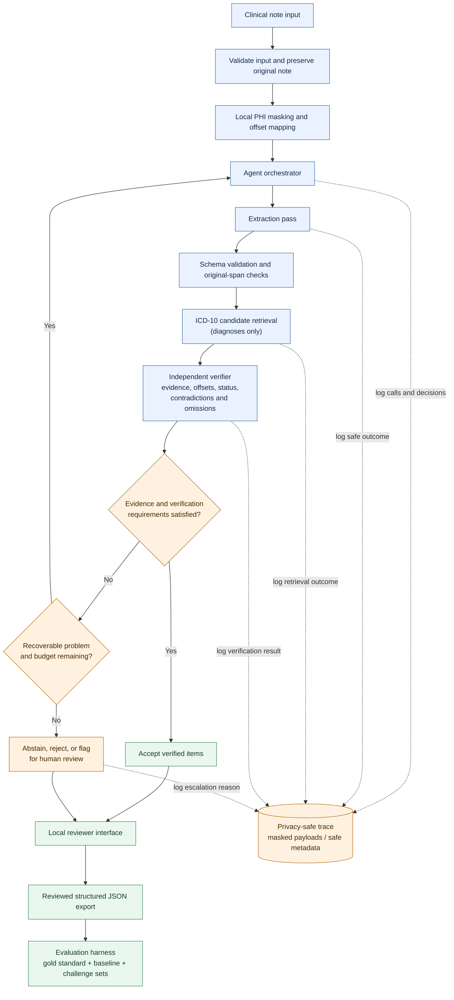

# Architecture, Technology Stack & Development Timeline

**Project:** AI-Powered Clinical Note Extraction and Coding Agent MVP  
**Planning window:** 13–26 October 2026  
**Document status:** Proposed submission document — pending formal Mirai Labs approval  
**Target environment:** Localhost MVP, one reviewer, English text notes, free-tier services only

> This document combines the three requested planning deliverables: system architecture, technology-stack justification, and detailed development timeline. All technology and model choices are provisional until Mirai Labs approves them. Do not begin feature implementation or send project clinical notes to an external model before the required approval and data-handling checks.

# Part I — System Architecture

## 1. Architecture Objective

The architecture describes how a clinical note moves through input validation, local privacy processing, structured extraction, ICD-10 diagnosis-candidate retrieval, independent verification, reconciliation, reviewer approval, and evaluation.

The original clinical note is the source of truth for evidence. An item must not be accepted merely because it is well-formed JSON or has a plausible diagnosis-code candidate.

The proposed system is an assistive review tool, not an autonomous clinical decision-maker. Uncertain or unsupported results must be rejected, abstained from, or routed for human review rather than presented as verified facts.

## 2. Proposed Components and Responsibilities

| Component | Responsibility |
|---|---|
| Input handler | Accept clinical note text and validate the input. |
| Local privacy layer | Detect and mask identifying information before any approved external model call. |
| Original-text and offset manager | Keep the original note unchanged and map positions in masked text back to original-note character offsets. |
| Agent orchestrator | Choose the next tool/pass, inspect outcomes, manage retry and time/call budgets, and decide whether to accept, retry, abstain, or escalate. |
| Extraction pass | Produce structured diagnoses, medications, procedures, allergies, and vital signs/key measurements with supporting evidence and stated status. |
| ICD-10 retrieval tool | Search the supplied ICD-10 table using keyword and semantic retrieval and return ranked diagnosis candidates. Procedure-code assignment is excluded. |
| Independent verification pass | Check source support, offsets, status, contradictions, and likely missed items without receiving the extractor's hidden reasoning. |
| Reconciliation and decision logic | Apply evidence gates, reconcile disagreements, reject unsupported items, and flag unresolved cases. |
| Privacy-safe trace | Record masked model/tool activity, retries, decisions, and results without exposing protected information. |
| Local reviewer interface | Show evidence, extracted fields, ICD-10 candidates, flagged items, trace, accept/reject controls, and JSON export. |
| Evaluation harness | Compare the proposed agent with the naive baseline and calculate SOW metrics and challenge-test results. |

## 3. Mermaid Architecture Diagram

The following Mermaid diagram is embedded in this Markdown file so it can be rendered by compatible Markdown viewers and GitHub.

**How to read it:** The orchestrator controls the processing loop. If a problem is recoverable and the retry/time/call budget allows it, the workflow can return to the orchestrator. If verification remains unresolved, the item is rejected, abstained from, or flagged for human review. A note may contain accepted items and items requiring review at the same time. The trace records process outcomes using masked payloads or safe metadata only.

## 4. One-Note Data Flow

1. **Receive input:** Accept an English clinical note through the local application.
2. **Preserve original text:** Keep the original note available locally for source-span validation and reviewer highlighting. Do not replace it with normalized or masked text as the source of truth.
3. **Mask locally:** Detect and mask identifying information before any approved external model call. Keep a mapping from masked text positions to original character offsets.
4. **Extract:** The extraction model proposes structured diagnoses, medications, procedures, allergies, and vital signs/key measurements, with relevant attributes, status, and supporting spans.
5. **Validate structure and spans:** Validate the schema and check that every proposed span maps to a valid location in the original note.
6. **Retrieve code candidates:** For diagnoses only, search the supplied ICD-10 table using keyword and semantic retrieval. Return ranked candidates, or a no-confident-match result if evidence is insufficient.
7. **Verify independently:** A separate pass receives the note and proposed extracted items, but not the extraction model's hidden reasoning. It checks evidence support, span validity, status, contradictions, and likely omissions.
8. **Reconcile:** The orchestrator examines tool outcomes and decides whether an item is accepted, rejected, retried, abstained from, or flagged for review.
9. **Record a safe trace:** Record tool calls, outcomes, retries, and decisions using masked payloads or safe metadata only.
10. **Review and export:** Display extracted fields, evidence and decisions in the reviewer interface; allow item-level accept/reject and JSON export.
11. **Evaluate:** Run the repeatable evaluation harness against manually labelled gold-standard data, the naive baseline, and the required challenge sets.

## 5. Evidence, Offsets, and Acceptance Rules

- **Original note is authoritative:** Evidence highlighting and span validation use offsets mapped back to the original note.
- **Masking must preserve the mapping:** If masking or preprocessing changes text length, offsets must not be reused without a verified mapping.
- **Evidence must support meaning:** A phrase may appear in a note without supporting the extracted interpretation. For example, “no evidence of pneumonia” must not be interpreted as a confirmed current pneumonia diagnosis.
- **Schema validation is necessary, not sufficient:** Valid JSON does not prove clinical correctness.
- **Accept:** The item passes structure, original-offset, evidence-support, required status, and verification checks.
- **Reject:** The item is unsupported, fabricated, incorrectly mapped, or contradicted by the source in a way that invalidates the claim.
- **Abstain/no confident match:** Use when the evidence or supplied ICD-10 table does not support a sufficiently reliable diagnosis-code candidate.
- **Human review:** Flag ambiguity, unresolved verifier disagreement, and items that cannot safely be accepted automatically.
- **Whole-note escalation:** Flag the note when it is outside the approved domain or crosses the agreed note-level disagreement/failure threshold.

## 6. Explicit Agent Loop and Recovery

The orchestrator must implement a real control loop; the application must not be only a fixed sequence of model calls.

1. Determine which processing pass or tool is needed next.
2. Invoke extraction, retrieval, verification, or deterministic validation.
3. Inspect the outcome and any error or verification reason.
4. Retry a recoverable failure only if the retry and time/call budgets allow it.
5. Re-evaluate the result after each retry; never assume a retry succeeded.
6. Accept only items that pass the agreed evidence and verification rules.
7. Otherwise reject, abstain, or escalate for human review.
8. Record the tool call, retry reason, decision, and outcome in the privacy-safe trace.

Retry limits, time/call budgets, and note-level escalation thresholds must be documented and evaluated. They must not be used to hide failures.

## 7. Trust Boundaries and Safety Controls

| Boundary or risk | Required control |
|---|---|
| Raw note and protected information | Keep raw-note processing local and follow Mirai Labs' data-handling rules. |
| External model provider | Send only appropriately masked text after the provider terms and use have been approved. Masking alone does not prove compliance. |
| Instructions embedded in a note | Treat note content as untrusted data; embedded instructions must not override system instructions or change tool permissions. |
| Trace/log exposure | Do not display or persist protected information in traces. Store masked payloads or safe metadata only. |
| Unsupported extraction | Require valid source evidence and verification before automatic acceptance. |
| Weak ICD-10 match | Return ranked candidates and allow no-confident-match rather than forcing a code. |
| Provider outage or rate limit | Fail safely, preserve safe local state, and flag or defer processing rather than fabricate output or switch to an unapproved provider. |

## 8. Reviewer Interface

The local reviewer interface must support:

- Displaying the original note.
- Highlighting evidence at mapped original-source offsets.
- Showing a structured table of extracted entities, attributes, status, and ICD-10 candidates.
- Item-level accept/reject controls.
- A flagged-items panel with reasons.
- A trace viewer showing process steps, tool calls, retries, and decisions without protected information.
- JSON export of reviewed results.

The MVP is for one local reviewer. Cloud deployment, multi-user collaboration, and EHR/billing integration are excluded.

## 9. Evaluation Boundary and Required Measures

The evaluation harness is separate from runtime decision-making. It measures the proposed system against manually labelled data and a naive single-prompt baseline.

The SOW-aligned evaluation plan requires:

- At least 100 manually labelled notes across at least 10 specialties, labelled before prompt tuning.
- Entity-level precision, recall, and F1 for diagnoses, medications, and procedures.
- Programmatic original-span/offset faithfulness checks with sampled manual review.
- ICD-10 top-1/top-3 metrics and rare-diagnosis no-confident-match performance.
- At least 20 modified contradiction notes, at least 10 rare-diagnosis notes, and at least 10 adversarial notes.
- Abstention/flagging precision and recall, end-to-end latency, model calls per note, quota/usage reporting, and analysis of at least three poor-performing cases.
- Results for all acceptance targets marked pass, fail, or not yet measured.

Important SOW targets include diagnosis F1 of at least 0.80, medication F1 of at least 0.85, 100% evidence faithfulness for accepted items, at least 90% status correctness for accepted diagnoses and medications, ICD-10 top-3 accuracy of at least 75%, at least 80% of contradiction cases flagged, at least 80% correct no-confident-match behaviour on the rare-diagnosis set, 100% correct handling on the adversarial set, and median latency below 30 seconds per note.

These are targets, not measured results. No target may be claimed as achieved before evaluation.

## 10. Architecture Risks to Validate

- Compatibility of the chosen model/API and availability of its free-tier quota.
- Approval of provider data-use and retention terms.
- Correctness of offset mapping after masking and preprocessing.
- Verifier performance on contradictions, status errors, and missed entities.
- Retrieval quality for rare diagnoses or diagnoses not supported by the supplied ICD-10 table.
- Whether annotation, implementation, evaluation and demo work can fit the available schedule.
- Whether the median-latency target is met under the measured environment.

## 11. Architecture Scope Boundaries

**Included:** English text notes supplied by Mirai Labs; extraction of diagnoses, medications, procedures, allergies, and vital signs/key measurements; original-source evidence and offsets; ICD-10 diagnosis candidates; independent verification; an explicit agent loop; privacy-safe tracing; local review; JSON export; and evaluation.

**Excluded by the SOW:** OCR/scanned or handwritten notes, procedure-code assignment, EHR/billing integration, cloud or multi-user deployment, model fine-tuning, external clinical-note sourcing, paid API keys, and GPU-dependent infrastructure.

## 12. Architecture Approval Status

This is a proposed logical architecture and does not authorize implementation. Final provider/model selection, retrieval implementation, masking rules, retry limits, and other pending decisions require verification and formal Mirai Labs approval before feature work or model calls using project clinical notes begin.

# Part II — Technology Stack and Justification

## 13. Technology Decision Criteria

| Criterion | Why it matters |
|---|---|
| Fit to the SOW | Must support extraction, verification, ICD-10 retrieval, review, traceability, and evaluation. |
| Free-tier availability | Paid API keys and GPU-dependent infrastructure are not permitted by the stated constraints. |
| Privacy and data use | Notes must be masked locally; provider terms must be acceptable to Mirai Labs before use. |
| Structured output | Extraction results must follow a strict schema and include evidence spans. |
| Independent verification | The verifier must be a separate pass and must not receive the extractor's hidden reasoning. |
| Rate limits and latency | Multi-pass calls and bounded retries affect throughput and the median-under-30-seconds target. |
| Simplicity | The MVP is local and single-reviewer; unnecessary production infrastructure should be avoided. |

## 14. Proposed Stack

| Layer | Proposed technology | Purpose and rationale |
|---|---|---|
| Core language | Python 3.12.x; exact patch to be pinned after testing | Supports NLP, data processing, API clients and repeatable evaluation in one environment. |
| Schema validation | Pydantic 2.x | Validates required fields and data types. Schema validity alone does not prove clinical correctness. |
| LLM API | Provisional Groq API candidates, subject to privacy review and approval | Offers hosted model candidates with documented free-plan quotas. |
| Agent orchestration | Explicit Python agent loop | Makes tool use, bounded retries, reconciliation and escalation inspectable. |
| Keyword retrieval | SQLite FTS5 or BM25; choose one after testing | Retrieves diagnosis candidates by terms and ranks matches. |
| Semantic retrieval | ChromaDB with a compatible local embedding model, such as bge-small-en | Retrieves potentially related diagnosis descriptions when wording differs. |
| Local privacy processing | Rule-based masking plus spaCy NER | Detects and masks likely identifiers before approved model calls. |
| Reviewer interface | Streamlit | Provides evidence highlighting, accept/reject controls, flagged items, trace viewing and JSON export locally. |
| Local persistence | SQLite/local files only where required | Stores review metadata and evaluation outputs without a separate database server. |
| Trace format | Structured JSON with masked payloads or safe metadata | Records tool calls, decisions, retries and outcomes without exposing protected information. |
| Evaluation | Python scripts and automated tests | Computes metrics and runs required robustness tests. |
| Version control | Git and private GitHub repository | Tracks documentation and implementation changes. |

Exact package versions must be pinned only after a clean-environment test confirms compatibility.

## 15. LLM Candidates and Provisional Recommendation

The SOW's Gemini and Groq model IDs are reference examples. Candidate details below were checked against provider documentation on 15 October 2026; availability and terms must be rechecked before implementation.

| Candidate | Documented status at research check | Potential use | Important limitation |
|---|---|---|---|
| Groq `openai/gpt-oss-20b` | Listed as supported; free-plan limits documented; strict JSON-schema output supported | First candidate for structured extraction | Clinical extraction quality must be measured on approved examples. |
| Groq `qwen/qwen3.8-27b` | Listed as supported; free-plan limits documented; strict JSON-schema output supported | Candidate for independent verification | Do not assume it is more accurate simply because it is a different model family; verify by evaluation. |
| Google `gemini-3.1-flash-lite` | Listed as available with a free tier | Alternative to evaluate if policy permits | Google's pricing documentation states that free-tier content may be used to improve products, requiring careful privacy review for clinical text. |

### Provisional configuration to evaluate

1. **Extraction:** Groq `openai/gpt-oss-20b`.
2. **Independent verification:** Groq `qwen/qwen3.8-27b`.

This pair is a starting point for controlled evaluation because both candidates were documented as supporting strict JSON-schema output and come from different model families. It is not a final decision and does not establish clinical quality.

The Groq model `llama-3.3-70b-versatile` should not be used as the default candidate: the deprecation documentation reviewed for this plan listed its shutdown date as 16 August 2026.

### Provider privacy and data-use requirement

Groq documentation states that inference inputs and outputs are not retained by default, but data may be temporarily retained for reliability troubleshooting or abuse monitoring unless applicable controls prevent it. This does not replace Mirai Labs' approval or data-use review.

Google's free-tier documentation states that content may be used to improve its products. Do not send clinical notes to any provider until Mirai Labs confirms that the provider's applicable terms and configuration are acceptable. Local PHI masking remains mandatory, but masking alone does not guarantee removal of every identifier.

### Free-tier capacity risk

The Groq rate-limit documentation reviewed for this plan listed free-plan limits of 1,000 requests per day for the two proposed candidates, with model-specific token limits. Account-specific limits must be checked before implementation.

A two-pass design can require at least two model requests per note. At two calls per note, 1,000 requests would theoretically cover at most 500 notes per day before retries, failures or additional calls. Processing all approximately 5,000 notes may therefore exceed the daily request budget. Confirm the required processing volume and actual quota; do not silently reduce the agreed scope.

## 16. Technology Justifications

### 16.1 Python

Python is proposed because it supports data manipulation, text processing, API clients, NLP libraries and repeatable evaluation in one environment. Node.js is possible, but Python is a direct fit for the NLP and evaluation workload.

### 16.2 Pydantic

Pydantic validates the structure of extraction and verification results. It catches missing fields, incorrect types and schema errors. Evidence existence, original offsets, clinical support and status correctness require additional validation logic.

### 16.3 Explicit agent loop

A small Python loop is preferred over a large orchestration framework because the SOW requires deliberate tool calls, bounded retries, reconciliation and escalation. Keeping those decisions explicit makes the process easier to inspect and test.

### 16.4 Keyword and semantic ICD-10 retrieval

Keyword retrieval is transparent and can find exact terms. Semantic retrieval may find relevant descriptions when the note uses different wording. Their combined value must be measured against a keyword-only comparison.

SQLite FTS5 and BM25 are alternatives for lexical retrieval; select one based on implementation simplicity and evaluation. ChromaDB is a candidate vector store for embeddings. Similarity scores must not be treated as proof that a code is clinically correct.

### 16.5 Local privacy processing

Rule-based matching can detect predictable patterns such as phone numbers and email addresses. spaCy NER may identify names, dates and locations based on context. Neither is guaranteed to detect every identifier. Masking must be tested, and a mapping between masked text and original offsets must be preserved.

### 16.6 Streamlit

Streamlit offers a fast path to a local review interface. React and a separate backend would add frontend work that is not needed for a single-reviewer localhost MVP.

### 16.7 SQLite and local files

SQLite and local files avoid the operational overhead of running a database server. Store only data needed for the local review and evaluation workflow. Keep raw protected information out of traces and repository commits.

### 16.8 Structured JSON trace

Structured JSON makes model/tool calls, retries, decisions and verification outcomes inspectable. Store masked payloads or safe metadata only, and test traces for accidental exposure of protected information.

### 16.9 Evaluation scripts

Automated scripts provide repeatable entity metrics, span checks, ICD-10 measures, abstention analysis, adversarial tests and latency/call counts. A demo alone cannot establish that SOW acceptance targets have been achieved.

## 17. Alternatives and Scope Decisions

| Decision | Proposed choice | Alternative | Reason |
|---|---|---|---|
| Core language | Python | Node.js | Direct fit for NLP and evaluation tooling. |
| Schema | Pydantic | Manual JSON validation | Reusable typed validation. |
| Orchestration | Explicit Python loop | Heavy agent framework | Easier to inspect and control. |
| Lexical retrieval | SQLite FTS5 or BM25 | Exact substring matching only | Better retrieval/ranking support. |
| Retrieval approach | Keyword + semantic, subject to evaluation | Keyword-only | Potentially broader candidate retrieval; benefit must be measured. |
| UI | Streamlit | React frontend | Faster local MVP development. |
| Persistence | SQLite/local files | PostgreSQL service | No separate database server is required. |
| Deployment | Localhost | Cloud and multi-user deployment | Cloud deployment is excluded from the current scope. |

## 18. Version and Compatibility Policy

Python 3.12.x and Pydantic 2.x are proposed starting points, not confirmed tested combinations. Pin exact versions only after checking:

- Python/library compatibility.
- API SDK compatibility with the selected provider.
- ChromaDB and embedding-model compatibility.
- CPU and memory requirements.
- Reproducible dependency installation.

Do not label versions as tested unless they have actually been tested in the target environment.

## 19. Implementation Readiness Checklist

- [ ] Architecture and technology stack approved by Mirai Labs.
- [ ] Exact model IDs rechecked and accessible.
- [ ] Current free-tier quotas and rate limits recorded.
- [ ] Provider data-use terms reviewed and approved for this project.
- [ ] Extraction and verification schemas defined.
- [ ] Original-to-masked text offset mapping specified and tested.
- [ ] Keyword retrieval approach and embedding model selected.
- [ ] Trace outputs checked for protected information.
- [ ] Dependency versions tested and pinned.
- [ ] Gold-standard and evaluation procedures ready.

## 20. Technology Stack Recommendation and References

Begin evaluation with Groq `openai/gpt-oss-20b` for extraction and `qwen/qwen3.8-27b` for verification, provided Mirai Labs approves the applicable data-handling terms. Use Pydantic, an explicit Python agent loop, keyword and semantic ICD-10 candidate retrieval, local PHI masking, Streamlit, privacy-safe JSON tracing and a repeatable evaluation harness.

Keep the model pair provisional until privacy approval, account-specific quota checks and evaluation demonstrate that the configuration meets project requirements. Recheck model availability before implementation because provider model catalogues and free-plan limits can change.

Official references:

1. Mirai Labs, *Statement of Work: AI-Powered Clinical Note Extraction and Coding Agent MVP*, version 1.0, 13 October 2026.
2. Groq, [Supported Models](https://console.groq.com/docs/models).
3. Groq, [Rate Limits](https://console.groq.com/docs/rate-limits).
4. Groq, [Structured Outputs](https://console.groq.com/docs/structured-outputs).
5. Groq, [Your Data in GroqCloud](https://console.groq.com/docs/your-data).
6. Groq, [Model Deprecation](https://console.groq.com/docs/deprecations).
7. Google, [Gemini API Models](https://ai.google.dev/gemini-api/docs/models).
8. Google, [Gemini API Pricing and Data-Use Terms](https://ai.google.dev/gemini-api/docs/pricing).
9. Pydantic, [Official Documentation](https://docs.pydantic.dev/).
10. Streamlit, [Official Documentation](https://docs.streamlit.io/).
11. Chroma, [Official Documentation](https://docs.trychroma.com/).
12. spaCy, [Official Documentation](https://spacy.io/usage).
13. Python, [Official Documentation](https://docs.python.org/).

*Provider details in this section were researched on 15 October 2026. Recheck them before implementation. Documentation of availability is not project approval.*

# Part III — Development Timeline

## 21. Fixed Milestones and Approval Gate

| Date | Milestone / deliverable | Constraint |
|---|---|---|
| Tue, 13 Oct 2026 | Review the SOW, identify scope and constraints, prepare clarification questions, begin market research | Planning and research only. |
| Tue, 13–Wed, 14 Oct 2026 | Review commercial products, open-source tools, research papers and relevant methods | Record sources; distinguish documented facts from assumptions. |
| Wed, 14 Oct 2026 | Research presentation | Present findings and gaps relevant to the proposed MVP. |
| Thu, 15 Oct 2026, by 6:00 PM | Submit solution proposal, architecture, technology-stack rationale and detailed timeline | Documents must clearly label unapproved choices. |
| Fri, 16 Oct 2026 | Architecture and technology review / formal approval gate | Do not begin feature implementation until approval is received. |

## 22. Post-Approval Execution Plan

Implementation starts only after formal approval. The planned post-approval build window is six working days: 19, 20, 21, 22, 23 and 26 October.

| Date | Planned work and deliverable | Verification / risk control |
|---|---|---|
| Fri, 16 Oct | Record approval decisions, settle permitted provider and data-handling requirements, confirm processing volume and scope | No implementation before approval; unresolved privacy or provider decisions remain blockers. |
| Mon, 19 Oct | Inspect the supplied dataset and ICD-10 table; finalize annotation guidelines and sampling plan; begin gold-standard labelling; define the naive single-prompt baseline | Gold-standard labelling must begin before prompt tuning. Confirm data access and specialty coverage. |
| Tue, 20 Oct | Continue labelling toward at least 100 notes across at least 10 specialties; define and test output schema and original-text offset rules; create the evaluation-harness skeleton | Track annotation throughput and disagreements. Keep final test examples separate from prompt-tuning examples. |
| Wed, 21 Oct | Implement approved local input handling and PHI masking; implement the structured extraction pass and schema validation | Test masked-to-original offset mapping; reject outputs with invalid or unsupported evidence. |
| Thu, 22 Oct | Implement ICD-10 keyword and semantic candidate retrieval; add ranked candidates and the no-confident-match outcome; run initial retrieval checks | Use the supplied code table. Monitor API quotas and avoid unsupported code claims. |
| Fri, 23 Oct | Implement independent verification, bounded retries, reconciliation, abstention/escalation and privacy-safe tracing; begin integrating reviewer controls | Test contradictions, missed entities, retry-limit behaviour and instructions embedded in notes. |
| Mon, 26 Oct | Complete reviewer UI and JSON export; finish integration; run evaluation and challenge tests where labelled data is ready; report metrics and at least three poor-performing cases; finalize README, user guide, 5–8 minute demo video and final defense materials | Mark each target pass, fail or not yet measured. Document incomplete tests, quota failures and unresolved limitations. |

## 23. Required Evaluation Work in the Timeline

- Gold standard: at least 100 manually labelled notes across at least 10 specialties, labelled before prompt tuning.
- Baseline: compare the proposed agent with a naive single-prompt baseline on the same agreed evaluation notes.
- Entity metrics: precision, recall and F1 for diagnoses, medications and procedures.
- Evidence: programmatic original-span/offset checks with sampled manual review.
- ICD-10: top-1 and top-3 metrics and correct no-confident-match behaviour for rare diagnoses.
- Challenge data: at least 20 modified contradiction notes, at least 10 rare-diagnosis notes and at least 10 adversarial notes containing embedded instructions and/or protected information.
- Operations: median end-to-end latency, model calls per note and cost/quota observations.
- Error review: describe at least three poor-performing cases and likely causes.

The acceptance thresholds are defined in `docs/evaluation-plan.md`. The timeline does not assert that any target has already been met.

## 24. Capacity, Dependencies, and Contingencies

The six-day implementation window is tight given the required labelling, multi-pass agent, reviewer interface, evaluation and final demo. The plan depends on timely access to the supplied data, ICD-10 table and approved model/API.

- Start labelling after approval and before prompt tuning.
- Track labelled-note count and specialty coverage daily.
- If annotation throughput, API quotas or privacy approval threatens a deliverable, raise the constraint with Mirai Labs promptly.
- Do not silently reduce gold-standard or challenge-set sizes, remove evaluation requirements or switch to an unapproved provider.
- If an SOW target cannot be measured by 26 October, record the limitation and mark it **Not yet measured** rather than claiming success.
- Use only Mirai Labs-provided clinical notes; do not source external clinical notes.

## 25. Timeline Scope Boundaries

The plan excludes OCR/scanned or handwritten notes, procedure-code assignment, EHR or billing integration, cloud or multi-user deployment, model fine-tuning, paid API keys and GPU-dependent infrastructure, consistent with the SOW.

## 26. Timeline Approval Status

This timeline is a planning baseline, not permission to begin implementation. Feature work starts only after formal Mirai Labs approval. Final model, provider and retrieval decisions must satisfy the approved privacy, free-tier and compatibility requirements.

---

## Submission checklist

Before submitting this document, confirm that:

- [ ] Architecture, technology stack, and detailed timeline are all present in this single `architecture.md` file.
- [ ] The architecture diagram is written as a fenced Mermaid block and renders in the intended Markdown viewer.
- [ ] Each technology choice includes its purpose, rationale, alternatives/limitations, and approval status.
- [ ] The timeline includes the 15 October submission milestone, 16 October approval gate, and the planned work through 26 October.
- [ ] Unmeasured performance targets are described as targets, not results.
- [ ] Privacy requirements and the no-implementation-before-approval gate remain explicit.
