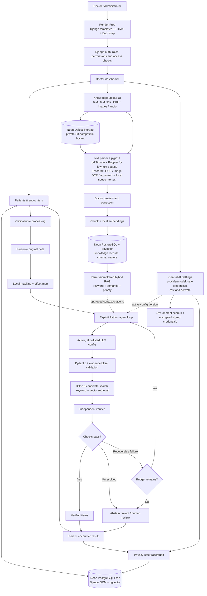

# Solution Proposal — Hosted, Doctor-Centred Clinical Note Extraction and RAG MVP

**Revision date:** 16 October 2026  
**Status:** Revised proposal pending formal Mirai Labs approval  
**Target cost:** ₹0 for the bounded evaluation demo; free tiers and free/open-source tools only  
**Recommended stack:** Django + HTMX + Bootstrap; Render Free; Neon PostgreSQL + pgvector + Object Storage; configurable approved LLM provider.

> This revision adds hosted multi-user patient management, a doctor-managed multimodal knowledge base, RAG, and a central model configuration screen. These items expand the original SOW's localhost/single-reviewer/text-only scope. Do not process project clinical notes or media in hosted/external services until Mirai Labs approves the expanded scope and data-handling terms in writing. Use synthetic data for development and public demos meanwhile.

## 1. Proposed Product

Build a hosted clinical-workflow assistant focused on the doctor's daily tasks. After login, a doctor sees their authorized patients, current and previous encounters, pending AI-review items, a managed reference knowledge base, and central AI settings. The system extracts structured clinical items from a note, retrieves supported ICD-10 diagnosis candidates, checks outputs against original-note evidence, and offers a reviewer workflow.

The application is assistive. It does not autonomously confirm diagnoses, prescribe treatment, or replace clinical judgement. Outputs remain subject to doctor review.

## 2. Requirements Baseline

### Retain the original SOW requirements
- Extract diagnoses, medications, procedures, allergies, and vitals/key measurements from supplied English clinical notes.
- Preserve the exact original note and require evidence text plus character offsets into that original note for accepted items.
- Retrieve and rank ICD-10 diagnosis candidates from the supplied table using lexical and semantic retrieval; abstain/no-confident-match when evidence or reference candidates do not support a reliable code.
- Extract procedure mentions but do not assign procedure codes.
- Independently verify evidence support, offsets, status, contradictions, and likely omissions.
- Use an explicit agent loop for tools, bounded retries, reconciliation, abstention, item-level human review, and whole-note escalation when required.
- Provide a safe trace, reviewer controls, evidence highlighting, and reviewed JSON export.
- Preserve the SOW's labelled gold standard, baseline comparison, challenge tests, metric thresholds, latency/call reporting, and error analysis.

### Requested expansion — pending scope approval
- Hosted doctor dashboard with login and role-based permissions.
- Patient profiles, encounter history, previous/current notes, review history, and access controls.
- Dynamic doctor-managed knowledge base supporting typed text, text files, PDFs (including multi-page PDFs), images, and voice/audio.
- PDF text extraction with page-by-page OCR fallback for scanned pages, image OCR, and speech-to-text; all extracted content is previewed/corrected before indexing.
- RAG across approved reference knowledge and separately scoped patient history.
- Doctor-set knowledge priority, constrained by relevance and permissions.
- Central UI page for selecting/testing/activating the active provider/model and supported parameters.
- Free-tier hosting, managed persistent database, vector search and object storage.
- No React; use Django templates + HTMX + Bootstrap.

These expansions must not silently replace the SOW's acceptance targets or allow excluded features to be treated as already approved.

## 3. Doctor-Centred User Journey

1. **Login:** Authenticate the user; resolve Doctor or Administrator permissions.
2. **Dashboard:** Show recent authorized patients, current/past encounters, pending review items and recent activity. Numbers are database-driven, not hardcoded.
3. **Patient record:** Open only a record the user is authorized to access. Show patient overview, encounter list, notes, review outcomes and source dates.
4. **Encounter:** Select a current encounter or create one. Keep each note, processing run and reviewer decision connected to the correct patient and encounter.
5. **Clinical note:** Submit an approved text note. Preserve original text before any transformation.
6. **Extraction pipeline:** Mask locally, run structured extraction, validate schema/spans, retrieve ICD candidates, verify independently, and reconcile.
7. **Review:** Show source evidence highlights, current/historical/negated/uncertain status, candidate codes, flagged reasons and trace-safe activity. Let the doctor accept/reject/flag items.
8. **Save:** Persist the reviewed result as part of that encounter without silently overwriting the original note or previous processing run.
9. **Knowledge Base:** Add text, text files, PDFs, images, and audio; preview/correct extracted text or transcription; publish/edit/version/deactivate records; and set metadata/priority.
10. **RAG:** Retrieve permitted, relevant knowledge and source citations; keep reference knowledge distinct from patient-note evidence and patient-specific history.
11. **AI Settings:** Configure the active provider/model centrally, test using synthetic inputs, and activate only a successful/approved configuration.
12. **History/export:** Inspect prior runs and review actions; download reviewed JSON if authorized.

## 4. Proposed System Architecture

The Django application contains the presentation, business logic, patient access checks, orchestration services, and settings screens. Neon is the proposed managed PostgreSQL host. pgvector stores embeddings in the same database. Neon Object Storage stores original uploaded files in private buckets, after its access controls and Python/S3 integration pass a smoke test.

The diagram is the proposed target. Each component and integration must be implemented and tested; the diagram is not evidence of current implementation.

## 5. Clinical Note Extraction Logic

1. Receive the selected encounter's note through the approved workflow.
2. Preserve the original string immutably; use it as the source for validation and highlights.
3. Detect/mask identifiers locally before an approved external model request. Save a tested map from transformed-text offsets back to original-note offsets.
4. Call the active model using an explicit extraction prompt and a strict output schema.
5. Validate schema fields with Pydantic, then separately validate span bounds, exact evidence text and original-offset mapping.
6. Extract the required categories: diagnosis mentions/status, medication name/dose/route/frequency/status where stated, procedures/status, allergies, and vitals/measurements/units where stated.
7. Retrieve diagnosis-code candidates from the supplied ICD-10 table. Use PostgreSQL full-text/keyword retrieval and a pgvector semantic path if it demonstrates value. Do not assign procedure codes.
8. Pass the note and proposed structured items to an independent verification call without supplying the extractor's hidden reasoning.
9. Check evidence support, offsets, current/absent/uncertain/historical status, contradiction signals, and likely omissions.
10. The explicit orchestrator reconciles results. Accept only items passing the agreed gates; reject unsupported results, abstain on weak code matches, retry only recoverable failures within the budget, and flag unresolved items.
11. Persist the original note, structured output, run/model configuration identifier, review decision and safe process metadata under the correct encounter.
12. Present output with highlighted evidence and export reviewed JSON.

A valid JSON object can still contain fabricated or unsupported information; schema validation, evidence validation, semantic verification, and clinical review are distinct controls.

## 6. Knowledge Ingestion and RAG

### Ingestion
1. Doctor enters text or uploads supported text, image, or audio.
2. Validate file type/content/size and reject unsupported or unsafe content.
3. Store the original uploaded object privately. Create a metadata record with owner, source, type, status, version, category, tags and priority.
4. Parse selectable PDF text page by page with pypdf. For pages with little/no selectable text, render only those pages to images using pdf2image + Poppler and run Tesseract OCR. OCR images and transcribe audio using a tested local component or an approved free-tier API.
5. Show extracted text/transcription to the doctor for correction and approval before publication.
6. Chunk the approved text. Generate embeddings using a local sentence-transformer model and store vectors/chunk metadata in pgvector.
7. Keep document version and chunk lineage, and update/remove stale vectors when the document is edited or deactivated.
8. Keep PDF page numbers in source metadata, enforce PDF page/file-size limits and timeouts, and surface parsing/OCR/transcription/embedding failures; never publish incomplete content silently.

### Retrieval
- Enforce user permissions, document status, tenant/patient scope and other metadata filters before ranking.
- Search keywords/full text and vector similarity, deduplicate, combine/rank results and return source citations.
- Allow the doctor to set priority for a knowledge record/category/source. Treat priority as a bounded ranking input among eligible relevant documents, not a substitute for relevance or clinical evidence.
- Apply a relevance threshold and provide a no-relevant-context outcome when appropriate.
- Reference knowledge, patient history, and current note evidence must remain clearly identifiable and separately scoped.
- Use the original note as proof for an extracted entity; reference knowledge can provide context, not claim presence in the note.
- Adding knowledge updates the index; it does not train or fine-tune the LLM.

## 7. Patient History and Access Logic

- Proposed roles: **Doctor** and **Administrator**. The exact permissions are pending approval.
- A doctor sees only authorized patient records and related encounters.
- All patient access checks are enforced in server-side views/services and queries.
- Current encounters and historical encounters are distinct; historical mentions must show their date/source.
- Retrieval must filter on the selected patient and authorization before text/vector ranking.
- Model run history and reviewer corrections are append-only or versioned to preserve traceability.
- Public hosted demo uses synthetic patient records, not project clinical records unless hosting is formally approved.

## 8. Central AI Settings

Create one central AI Settings page. Do not force doctors to configure separate extraction and verifier model settings for each task by default.

Controls:
- Approved provider/model selector.
- Masked API credential entry/update.
- Supported parameter settings with guardrails.
- Test connection/test response using synthetic input.
- Save Draft / Activate actions.
- Active configuration status, last test outcome, time, latency and errors.
- Audit event recording actor/time/config-version/model ID, never the secret.

Secrets must not be returned after storage. Use deployment environment secrets for encryption keys. Store an editable API secret only if necessary, encrypted at rest. Allowlist provider endpoints and prohibit arbitrary URLs. If the test fails, preserve the last known active configuration. If the model works technically but has not been approved for clinical data or not evaluated for quality, do not represent it as approved for project notes.

## 9. Proposed Technology Choices

| Component | Choice |
|---|---|
| UI | Django templates + HTMX + Bootstrap; no React |
| Web application | Django/Python |
| Free hosting | Render Free |
| Database | Neon PostgreSQL Free |
| Vector search | pgvector |
| Object/file storage | Neon Object Storage, private buckets; test access controls/integration first |
| File-storage contingency | Supabase Storage Free if Neon Object Storage fails a documented test |
| Local embeddings | Sentence-transformers candidate bge-small-en, subject to CPU/memory tests |
| Keyword search | PostgreSQL full-text search |
| PDF text extraction | pypdf | Extracts selectable text from ordinary PDFs without OCR; page-wise OCR fallback is needed for image-only/scanned pages. |
| PDF page rendering for OCR | pdf2image + Poppler (only when needed) | Converts only pages lacking usable text to images for Tesseract; adds a native dependency, so validate on Render Free. |
| OCR | Tesseract |
| Audio transcription | Tested local CPU option or approved free-tier service |
| Schema | Pydantic + custom evidence and offset validators |
| LLM | Configurable adapter; provider/model pending approval |
| Auth | Django auth, groups, permissions and server-side access checks |
| Evaluation | Python scripts/pytest and SOW-specific challenge sets |
| Source control | Private GitHub |

Exact dependencies/versions must be pinned only after compatibility and deployment tests.

## 10. Free-Tier Hosting Plan and Risks

The target is zero out-of-pocket cost for a limited demo, not guaranteed unlimited service.

- Render Free provides a public service URL but sleeps after inactivity and has ephemeral local storage. It may cold-start when the evaluator first opens the link.
- Neon Free documentation reviewed on 16 October 2026 lists 1 GB PostgreSQL storage/project, 100 CU-hours/project/month, and 5 GB public network transfer/project/month. Neon Object Storage is listed as 5 GB/project on the Free plan. Recheck before deployment.
- Keep all uploads in external object storage, not Render's local filesystem.
- Enforce upload-size and PDF page-count limits; restrict large audio files and expensive OCR/transcription. Use direct PDF text extraction first and OCR only the pages that need it.
- Local embedding/OCR/audio models must fit the free host's CPU and memory. If not, choose a smaller tested model or use an approved free-tier API; never silently use paid services.
- On quota exhaustion, show a useful message, defer processing, and retain safe state for retry.
- Public demo should use synthetic data and contain no secrets or private project documents.

## 11. Original SOW Evaluation and Expanded Product Tests

Retain original SOW evaluation targets from docs/evaluation-plan.md:
- Gold standard at least 100 labelled notes across at least 10 specialties, created before prompt tuning.
- Diagnosis F1 >= 0.80; medication F1 >= 0.85.
- 100% evidence faithfulness for accepted items; >= 90% status correctness for accepted diagnoses/medications.
- ICD-10 top-3 >= 75%; correct rare-diagnosis no-confident-match >= 80% on at least 10 cases.
- Flag >= 80% contradictions on at least 20 cases; handle at least 10 adversarial cases at 100%.
- Measurable improvement over naive single-prompt baseline; median latency < 30 sec/note; report call counts/quotas and at least three poor cases.

New product-specific checks:
- Login/logout and role permissions.
- Doctor cannot access an unauthorized patient's record, encounter, note, source file, history, or export.
- Current and previous encounters persist correctly across app restart/redeploy.
- Upload validation, private file access, PDF text/page provenance, scanned-page OCR preview/correction, audio transcription review, and rejected-upload handling.
- Knowledge CRUD, versioning, deactivation, re-indexing, metadata filters, and citation to the correct source.
- RAG priority cannot override permission filters or allow irrelevant text to win.
- Provider/model configuration can be tested, saved, activated, and audited without exposing credentials.
- A provider failure/rate limit leaves prior active configuration intact and never triggers paid fallback.
- Hosted link wakes and functions; database/files persist outside ephemeral app storage.
- Every expanded target should be labelled Pass/Fail/Not yet measured; do not infer success from a working page.

## 12. Scope and Approval Status

The hosted patient workspace, multi-user access, multimodal knowledge ingestion, RAG knowledge base, model setting UI, and cloud hosting are scope changes relative to the original SOW. Ask Mirai Labs to approve them in writing along with provider terms, storage/retention, and demo hosting. Until then, use synthetic data only. This proposal is planning documentation and is not a claim of implementation or formal approval.
